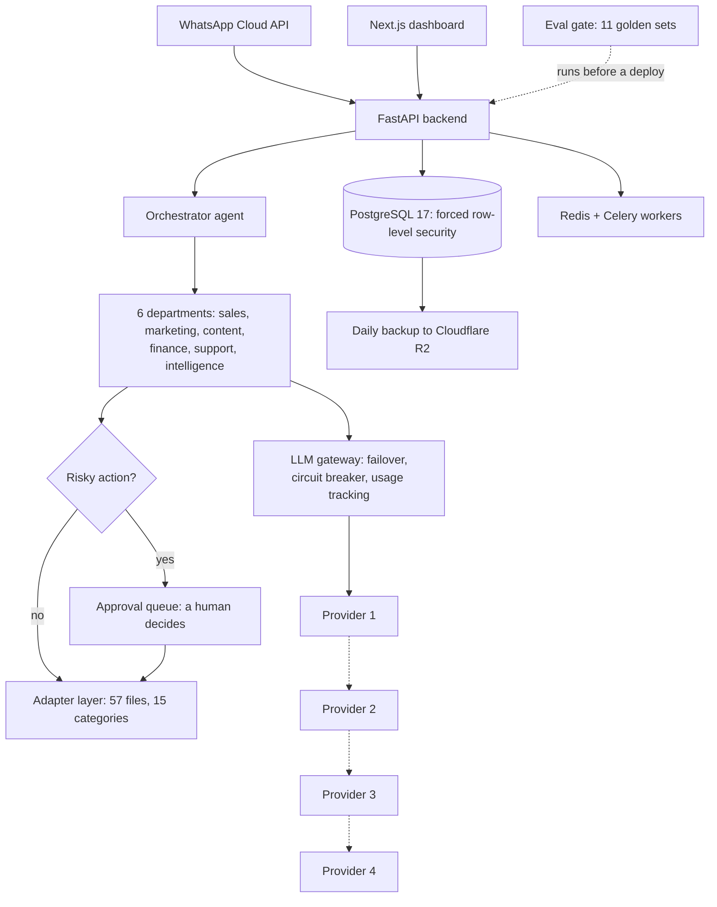

# ZestForAI: one AI platform for many small businesses

| | |
|---|---|
| **My role** | Founder and sole engineer: design, backend, AI, deployment, operations |
| **Period** | Feb 2026 – present |
| **Stack** | FastAPI · Next.js · PostgreSQL 17 · Redis · Celery · Docker · Coolify · Traefik |
| **Status** | Running on a self-hosted server with 7 tenants, all my own and family businesses. No paying customers yet. Code is private. |

## The problem

I run a visa consultancy, and my family runs other small businesses. Each one needs the same things: answer leads, follow up, create content and keep records. Most of that work happens on WhatsApp.

I first built a separate app for each business. That meant doing the same work again and again. So I changed the question: can one platform serve all of them, with each business as a separate tenant?

That one decision created four engineering problems.

| # | Problem | Why it matters |
|---|---|---|
| 1 | Tenant data must never mix | One business must never see another's leads or documents |
| 2 | LLM providers fail or run out of quota | A reply that never arrives is a lost lead |
| 3 | AI quality changes silently | A new model or prompt can make answers worse, and nobody notices |
| 4 | Agents take actions, not just write text | A wrong message sent to a customer cannot be taken back |

## Architecture

## What I built

### 1. Tenant isolation in the database

**Decision:** enforce isolation in PostgreSQL, not only in application code. Every tenant table has row-level security, and it is forced, so the rule applies even to the table owner. The app connects with its own limited role, never an admin account.

**Why:** a filter in application code protects data only until one query forgets it. A rule in the database still holds when the code has a bug.

**Trade-off:** every request must set its tenant first, and database migrations need more care.

### 2. An LLM gateway that expects providers to fail

**Decision:** no feature calls a model provider directly. Each task has a chain of models, free ones first. If a provider errors or runs out of quota, the gateway moves to the next one. A circuit breaker stops it from retrying a provider that is down. Usage is tracked.

**Result:** about 100 task-to-model chains across 4 providers. One provider hit its quota limit in production. Traffic moved to the next provider and the service stayed up.

**Trade-off:** different models give different quality for the same prompt. That is the reason for the next part.

### 3. An eval gate before a deploy

**Decision:** each customer-facing AI task has a golden set: real inputs with the answers I expect. Before a deploy, a script scores the production model on every set. If any task scores below the floor, the script exits with an error and names the task. I do not ship until it passes.

**Result:** 11 golden sets and 48 test items. They cover intent detection, lead classification, WhatsApp replies in English and Telugu, answers from documents (RAG), sales conversations and content tasks.

**Limits:** 48 items is a small set. My rule is that each bug found becomes a new test item, so the set grows with use. Today the gate is a step I run before deploying. It is written so it can run in CI without changes.

### 4. Agents with a human in the loop

**Decision:** an orchestrator agent hands work to 6 departments. An action that is risky does not run on its own. It waits in an approval queue until a person approves it.

For incoming WhatsApp messages, an intent classifier must reach 0.70 confidence before any automatic action. Below that, nothing is done automatically.

**Why:** a slow correct reply costs less than a fast wrong one.

### 5. WhatsApp and Telugu voice

The tenants serve Telugu-speaking customers, so the platform had to handle Telugu voice notes, not only typed English. The pipeline accepts a voice note, turns speech into text, sends it to the LLM, and returns the answer as Telugu speech.

### 6. One interface for outside APIs

Payments, WhatsApp, voice, LLMs, social media and storage each sit behind an adapter: 57 adapter files in 15 categories. Changing a provider means changing one adapter, not the features that use it.

In live use today: WhatsApp Cloud API, the LLM providers and Cloudflare R2. The rest are built but not yet proven in live use.

### 7. Operations and security

- **Deploy:** Docker, Coolify and Traefik on a self-hosted server.
- **Backups:** the database is backed up every day to Cloudflare R2. I have tested restoring from it.
- **Monitoring:** Sentry for errors, Netdata for the server, uptime-kuma for uptime.
- **Incident:** in April 2026 the server was compromised. I led the recovery and changed the setup: a network-level firewall, services bound to localhost, and authentication in front of every service. Ports published by Docker bypass the host firewall, so the host firewall alone was not enough.

## Numbers

| Measure | Value |
|---|---|
| Tenants | 7 (my own and family businesses, pre-revenue) |
| Agent departments under the orchestrator | 6 |
| LLM providers in the failover chain | 4 |
| Task-to-model chains | about 100 |
| Golden eval sets · test items | 11 · 48 |
| Adapter files · categories | 57 · 15 |
| Confidence needed before an automatic action | 0.70 |
| Commits | 630+ |

## What is not done yet

- **No paying customers.** The tenants are my own and family businesses.
- **Cost and speed are not measured.** I have no cost-per-reply or latency numbers yet, so I make no savings claim.
- **The eval sets are small,** and the gate is not yet part of CI.
- **No outside deployment yet.** The first one, with my own consultancy, is starting now. I will add its results here when they are measured.

## What I learned

1. **I built before I sold.** The platform has more features than proof of demand. The next work is one real deployment with measured results, not more features.
2. **Failover needs evals.** Switching models keeps the service up, but it can lower quality without anyone noticing. The two parts only work together.
3. **Put the rule where a bug cannot skip it.** Tenant isolation belongs in the database. Risky actions belong behind an approval step.
4. **Security is not a later task.** One exposed service was enough to compromise the whole server.
